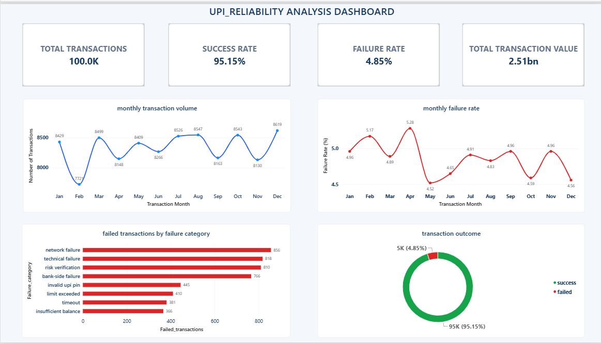
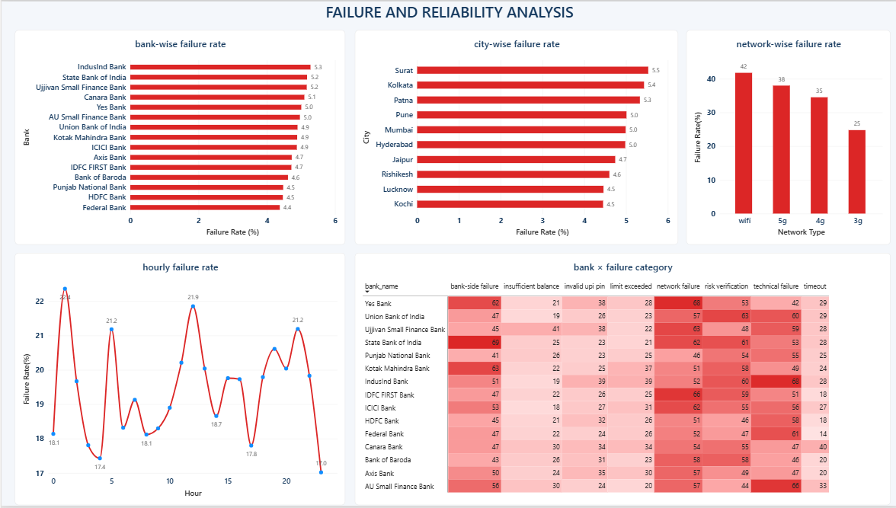
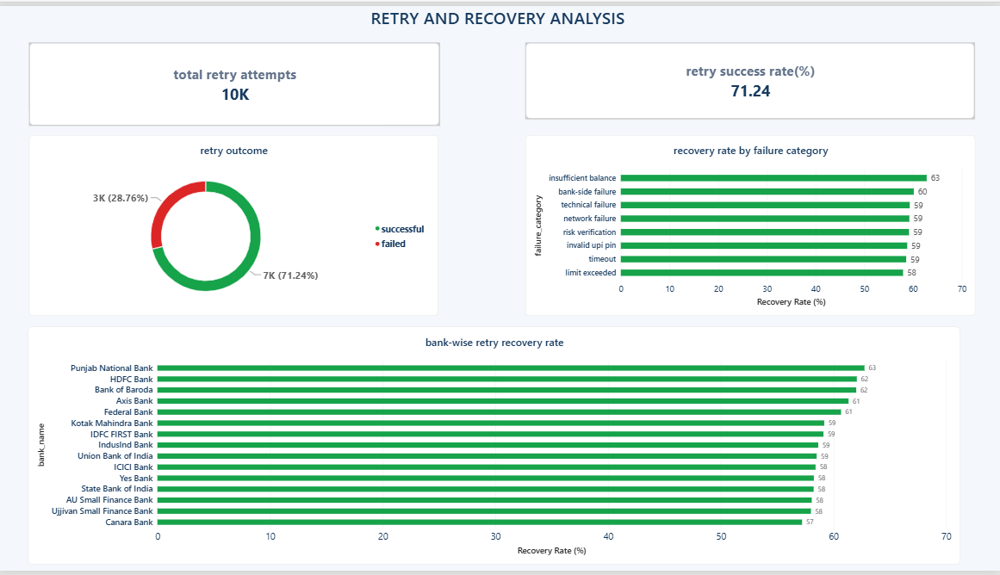
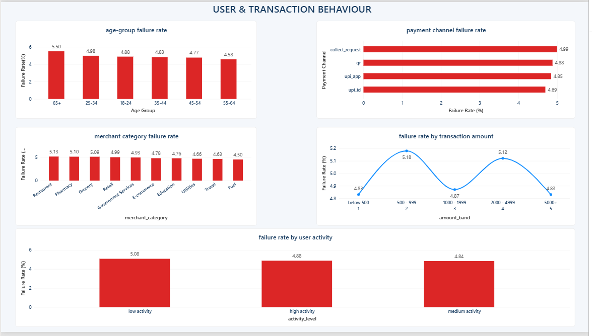
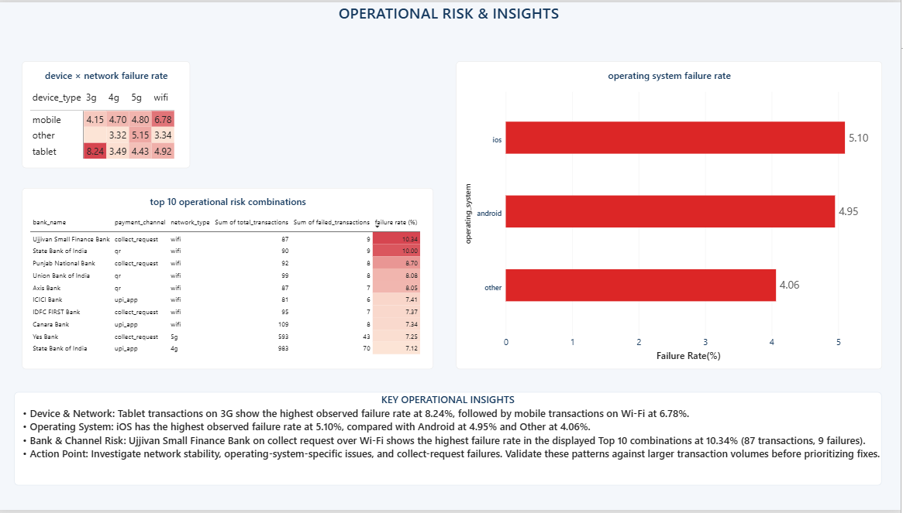

# UPI Transaction Reliability & Failure Analytics

An end-to-end data analytics project exploring UPI transaction failures, payment reliability, and retry recovery patterns using PostgreSQL, Python, and Power BI.

## Project Overview

This project analyzes synthetic UPI transaction data to understand transaction failures, payment reliability, and retry recovery patterns. It uses SQL for data generation and analysis, Python for data exploration, and Power BI to build an interactive, multi-page dashboard.

The goal is to identify patterns across banks, locations, payment channels, devices, networks, operating systems, transaction amounts, and user segments.

> **Data Disclaimer:** This project uses synthetic data generated for analytical and educational purposes. It does not contain real bank or customer transaction records.

## Business Problem

UPI payments can fail for different reasons, including network issues, technical errors, bank-side failures, invalid UPI PINs, and insufficient balance.

This project investigates:

- Which failure categories contribute to transaction failures?
- How do failure rates vary across banks, cities, channels, devices, and networks?
- How successful are retry attempts at recovering failed transactions?
- Which operational combinations may deserve further investigation?
- How do transaction amount and user activity relate to observed failure rates?

## Tools & Technologies

- **PostgreSQL:** Synthetic data generation, relational data modelling, SQL analysis, joins, aggregations, CTEs, and analytical views
- **Python:** Data extraction and analysis using Jupyter Notebook, pandas, and psycopg2
- **Power BI:** Interactive dashboards, KPIs, trend analysis, matrix visualizations, and conditional formatting
- **GitHub:** Project documentation and versioned source files

## Dataset Overview

The synthetic dataset is designed around:

| Dataset component | Records |
|---|---:|
| Users | 10,000 |
| Banks | 15 |
| Merchants | 2,000 |
| Locations | 20 |
| Devices | 12,000 |
| Transactions | 100,000 |
| Transaction attempts | 110,000 |

These figures describe the synthetic project dataset, not real-world UPI activity.

## Power BI Dashboard

The dashboard contains five analytical pages.

### 1. Executive Overview

Provides an overview of transaction volume, success and failure rates, monthly performance, and failure categories.



### 2. Failure & Reliability

Analyzes failure patterns across banks, cities, transaction hours, networks, and failure categories.



### 3. Retry & Recovery Analysis

Examines retry outcomes, recovery rates by failure category, and bank-level recovery performance.



### 4. User & Transaction Behavior

Explores failure rates by age group, payment channel, merchant category, transaction amount, and user activity.



### 5. Operational Risk & Insights

Compares device-network combinations, operating-system failure rates, and high-failure operational combinations.



## Key Analytical Findings

- **Retry success rate:** 71.24% across the analyzed second-attempt records.
- **Tablet transactions on 3G:** Observed failure rate of 8.24%.
- **Operating system comparison:** iOS showed a 5.10% failure rate compared with 4.95% for Android.
- **Operational risk combinations:** The highest failure rate among the displayed top 10 combinations was 10.34%, based on 87 transactions and 9 failures.

These findings are specific to the synthetic dataset. They should not be interpreted as actual bank performance or as proof of causation.

## Project Structure

```text
upi-transaction-reliability-analytics/
├── upi_reliability_analytics.sql
├── upi_transaction_reliability_analysis.ipynb
├── upi_transaction_reliability_dashboard.pbix
├── powerbi/
│   ├── executive_overview.png
│   ├── failure_reliability.png
│   ├── retry_recovery.png
│   ├── user_behavior.png
│   └── operational_risk.png
└── README.md
```

## How to Explore the Project

1. Review the SQL file to understand the schema, synthetic data generation, and analytical queries.
2. Run the SQL scripts in PostgreSQL in the required order.
3. Open the Jupyter Notebook and configure your local PostgreSQL connection using your own credentials.
4. Open the Power BI `.pbix` file in Power BI Desktop to explore the five dashboard pages.
5. Browse the `powerbi/` folder to view the dashboard screenshots.

## Limitations

- Results depend on the assumptions used to generate the synthetic dataset.
- Observed associations do not establish causation.
- Failure rates should be interpreted alongside transaction volumes.
- Findings cannot be generalized to real UPI users, banks, or payment systems.

## Author

**Ashutosh Kumar**

Data Analytics Project
